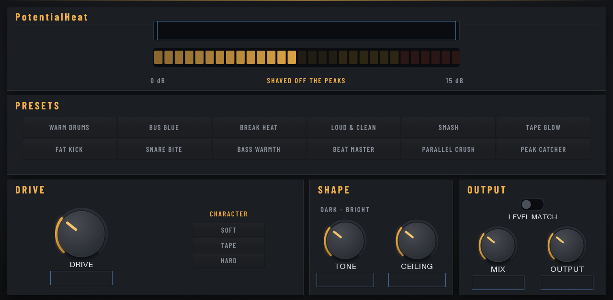

# PotentialHeat

**Warmth, glue and loudness.** A soft clipper and bus saturator for your MPC: push your drums, breaks or whole beat into a warm curve that rounds the peaks off instead of clipping. Louder, thicker and more together, without the harsh crackle. A natural partner for [PotentialPunch](https://github.com/PotentialBreakfast/mpc-vst-potentialpunch).

*Insert effect · MPC OS 3.x · Gen1 (32-bit) · v1.0.0*

Free and open source (MIT), made by **PotentialBreaks**. It runs inside the MPC like its own effects, with its own touchscreen page, Q-Link control and project recall, and no computer needed while you play.

**[Download the latest release](../../releases/latest)** · [Install guide](INSTALL-GUIDE.md) · [FAQ](FAQ.md) · [Ideas and bugs](../../issues/new/choose)

## What it does

| Control | What it does |
|---|---|
| **DRIVE** | How hard the sound is pushed into the curve, 0 to 24 dB |
| **CHARACTER** | **SOFT** (clean until near the top, then warm and smooth), **TAPE** (a little darker and rounder, like tape) or **HARD** (firmest and loudest) |
| **TONE** | Dark to bright, after the saturation |
| **CEILING** | The most the peaks can reach (-6 to 0 dB): it never clips past it |
| **LEVEL MATCH** | Turns the level down as DRIVE goes up, so you hear the colour, not just "louder". Switch it off to use it as a loudness clipper |
| **MIX / OUTPUT** | Blend with the original sound (parallel saturation), set the level |

The curves run at twice the sample rate inside, so even pushed hard it stays clean, without harsh fizz. A live meter shows how much is being shaved off the peaks.

**Presets** (one tap on the page, and in the MPC's PRESET menu): Warm Drums, Bus Glue, Break Heat, Loud & Clean, Smash, Tape Glow, Fat Kick, Snare Bite, Bass Warmth, Beat Master, Parallel Crush and Peak Catcher.

## How to use it

Add it as an **insert effect** on a track, program, pad or bus. It won't be in the instrument list. Tap a preset, then set how hard it works with **DRIVE**. On a drum bus, try it after PotentialPunch: Punch shapes the hits, Heat warms them up and catches the peaks.

## Limitations

- **It adds about 0.3 ms of delay** (15 samples) for the oversampling. The dry signal in MIX is delayed to match, so there's no phasing.
- **LEVEL MATCH is a rough match**, not exact loudness: trust your ears and use OUTPUT.
- **Stereo in, stereo out** (each side clipped on its own), at 44.1 kHz.
- **Tested on an MPC One only**, and on Gen1 hardware only.

## Will it work on my MPC?

| | |
|---|---|
| **Tested on** | MPC One (first generation) with HAKAI 3.10 firmware |
| **Should work on** | Other first-generation (Gen1, 32-bit) standalone MPCs running **MPC OS 3.x**: One, Live, Live II, X |
| **Not yet** | Gen2 hardware (MPC One+, Live III, Key 37, XL and others): no build yet. **MPC OS 2.x**: not supported |
| **You need** | A way to install third-party plugins on your MPC (see below) |

The **Should work on** row is untested so far. If you try it on another model, please [tell me how it went](../../issues/new/choose).

## Install

**👉 [Step-by-step install guide](INSTALL-GUIDE.md)**: start here if it's your first plugin.

The short version:
1. Download `PotentialHeat-<version>-mpc-armv7.zip` from [**Releases**](../../releases) and leave it zipped.
2. Install it with the free **MPC Plugin Installer** from [Open MPC](https://open-mpc.github.io/): connect, drop the zip in, press Install. Or install over SSH (see the guide).
3. **Save your project first.** Installing restarts the MPC app.
4. **PotentialHeat** is an **insert effect**: look in the insert effects, not the instrument list.

Stuck? The [**FAQ**](FAQ.md) covers the common problems.

## Also good to know

- **Made by one person, tested on one MPC.** It works well for me, but you may hit something I haven't. Please tell me if you do.
- **Plugins must be allowed to run on your MPC.** Stock firmware doesn't load third-party plugins until it has been set up for them (see [Open MPC](https://open-mpc.github.io/)). After a firmware update, you may have to redo that setup.
- **No warranty.** It's free and comes as it is. Back up your projects.

## Ideas, bugs and criticism: all welcome

I make these for myself first, and I want them to be good for everyone else too, so **please tell me what you think**, including what you don't like.

- 💡 [Suggest a feature](../../issues/new?template=idea.yml)
- 🐛 [Report a bug](../../issues/new?template=bug.yml)

You don't need to be technical. Short messages are great. See [CONTRIBUTING.md](CONTRIBUTING.md) for more, including how to send code.

## More from PotentialBreaks
- **[PotentialPunch](https://github.com/PotentialBreakfast/mpc-vst-potentialpunch)**: Transient shaper: more or less punch and tail on drums and anything else, with one-tap presets.
- **[PotentialPatina](https://github.com/PotentialBreakfast/mpc-vst-potentialpatina)**: Retro-colour insert effect: vinyl and tape noise, wobble, drive, bit-crush, tone and room in one box.

- **[PotentialBreaks](https://github.com/PotentialBreakfast/mpc-vst-potentialbreaks)**: Drum-break slicer: a random break from your library on 16 pads, chopped and tempo-matched.
- **[PotentialWax](https://github.com/PotentialBreakfast/mpc-vst-potentialwax)**: Melodic sampler: pick or dig a song from your library, 16 cues found for you, matched to your tempo and key.
- **[PotentialNoise](https://github.com/PotentialBreakfast/mpc-vst-potentialnoise)**: Calibrated pink noise reference for mixing: one-tap RMS levels, mono/stereo, full or limited range, live meter.
- **[MPC TOOLS](https://github.com/PotentialBreakfast/mpc-tools)**: a free second-screen app for Windows: your MPC's screen live on your PC (and in OBS), file transfer, your PC's folders on the MPC, and one-click "save the last 60 seconds".

## Build it yourself

See [BUILD.md](BUILD.md).

## Credits

- Built on **[mpc-vst-plugins](https://github.com/sd88me/mpc-vst-plugins)** by sd88me (MIT), the open kit that makes MPC plugins possible: the plugin wrapper, skin builder and installer.
- Fonts: **Barlow** and **Barlow Condensed** by Jeremy Tribby (SIL Open Font License 1.1), in `vst/skin/fonts/`.
- The dark look grew out of the theme I made for sd88me's Lucky Dip.
- Made with help from Claude (Anthropic).

Not affiliated with or endorsed by Akai Professional or inMusic. MPC is their trademark.

## Licence

[MIT](LICENSE): free to use, change and share, including in your own projects. Third-party parts keep their own licences ([THIRD_PARTY.md](THIRD_PARTY.md)).
